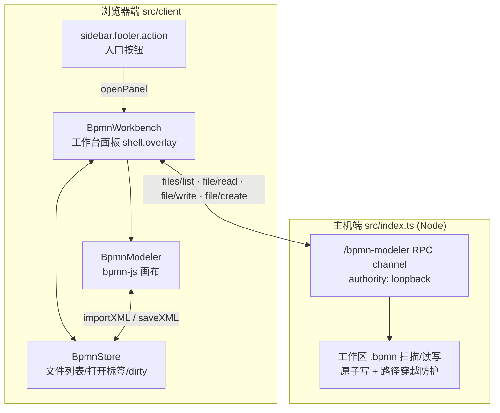

# dsh-bpmn

DeepSeek Harness（DSH）的 BPMN 2.0 可视化建模器插件——把 [bpmn.io](https://bpmn.io) 的 web 建模体验带进 DSH 的 Web GUI，对标 VSCode 的 [vs-code-bpmn-io](https://github.com/bpmn-io/vs-code-bpmn-io) 扩展。

> ⚠️ DSH 仍处于 `0.1.x-rc` 开发者预览阶段，slot / manifest API 可能在候选版本间变动。本插件基于 **dsh `0.1.1-rc.2`** 类型对照开发（2026-11-09），并在 **dsh `0.1.0-rc.6`** 运行时完成全链路实测（文件列表 / 打开 / 编辑 / Ctrl+S 保存 / 重开 / 新建 / 属性面板）。API 漂移时以当天 [deepseek-harness](https://github.com/deepseek-ai/deepseek-harness) 仓库源码为准。

## 功能形态（双面板设计）

|      | 工作台（建模模式） | 侧边预览（查看模式）             |
| ---- | ------------------ | -------------------------------- |
| 场景 | 专心画流程图       | 边和 agent 聊天边看它生成的 BPMN |
| 引擎 | bpmn-js `Modeler`  | bpmn-js `Viewer`（只读）         |
| 载体 | 贴边面板 + 全屏    | 右栏浮层（规划）                 |
| 状态 | v0.1 脚手架已就位  | v0.2 规划中                      |



## 安装

```sh
dsh plugin --profile web add dsh-bpmn
# 或本地开发安装
dsh plugin --profile web add /path/to/dsh-bpmn
```

然后重启 `dsh web`，侧边栏底部会出现 BPMN 入口按钮。

## 开发

```sh
pnpm install
pnpm run typecheck
pnpm run build      # tsc -b 编译到 lib/ 后 tsdown 打包出 lib/client.js
pnpm run test
pnpm run lint
```

### 免安装调试

```sh
# --patch 叠加层优先级最高，适合快速迭代（注意：name 需绝对路径指向入口或包名）
dsh web --patch ./dev.cordis.yml
# 验证插件是否真的挂载（没有 row 就是组合问题，有 row 无效果才是代码问题）
dsh --profile web --dump-config
```

DSH rc 版**没有热重载**（web profile 的 HMR 被上游禁用）：改代码后需要重启 `dsh web`；开发期把改动集中在少数文件、一切注册走 `ctx`，避免重启后泄漏重复注册。

## 路线图

- [ ] **v0.1** 工作台闭环：bpmn-js Modeler 画布 + 工作区 `.bpmn` 新建/打开/保存（Ctrl+S）+ dirty 状态 + 属性面板（功能已就位并实测，收尾：测试用例 / lint）
- [ ] **v0.2** 侧边预览：只读 Viewer + 会话内 `.bpmn` 文件链接拦截点击预览 + 一键"在建模器中打开"
- [ ] **v0.3+** bpmnlint 校验、属性面板汉化、DMN（dmn-js）、agent 按图执行联动

交接与实现细节见 [docs/HANDOFF.md](docs/HANDOFF.md)（含 DSH 插件机制速查、待确认 API 清单和参考链接）。

## License

MIT
